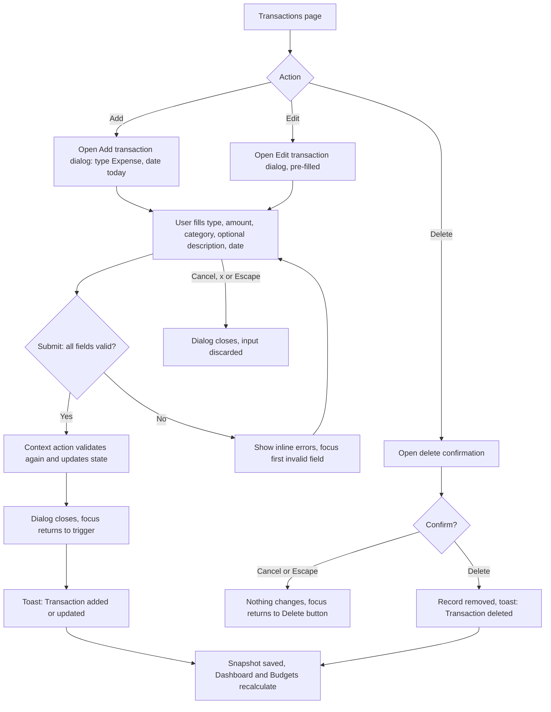
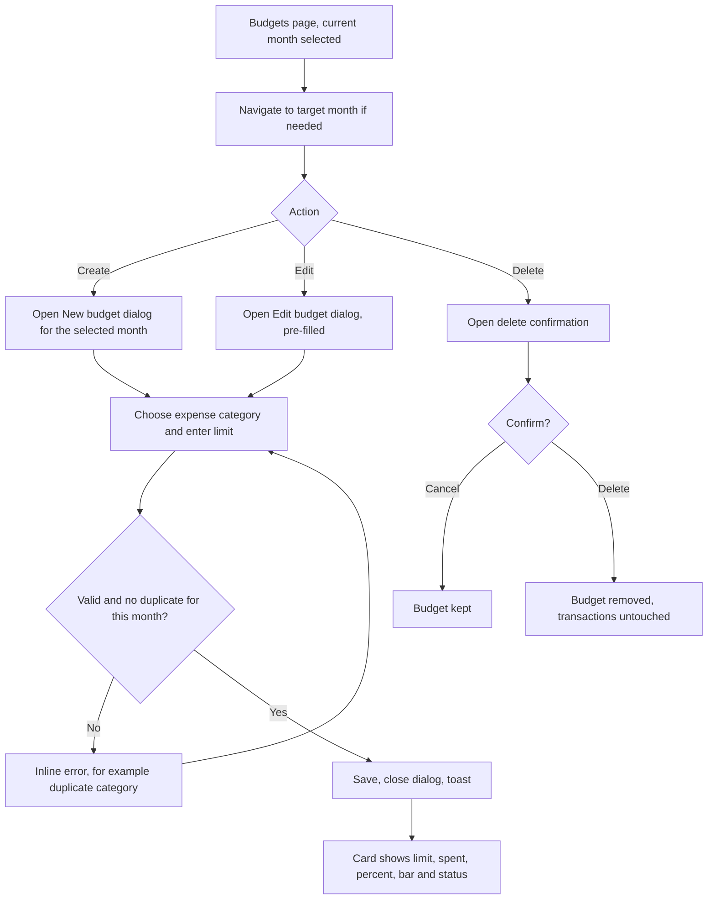
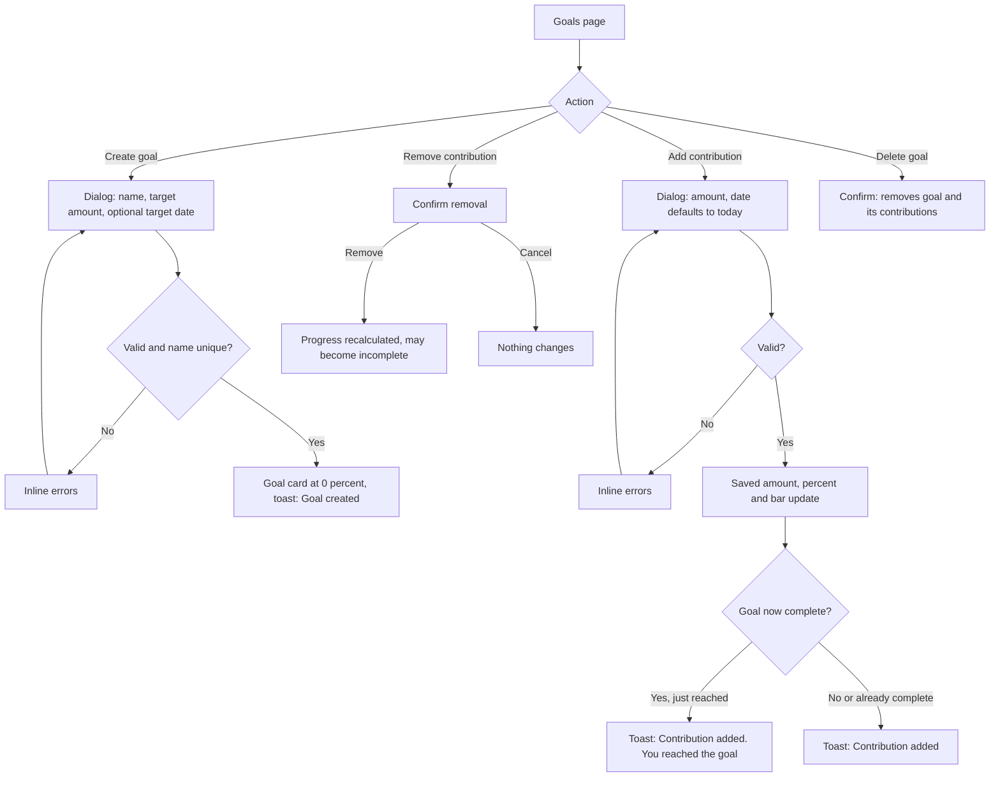
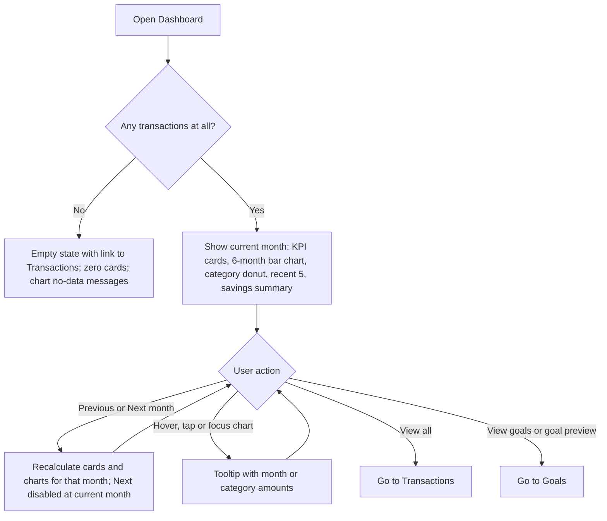
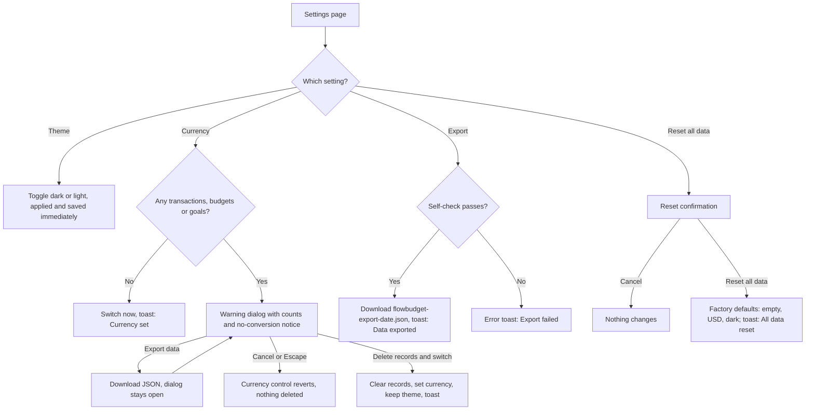
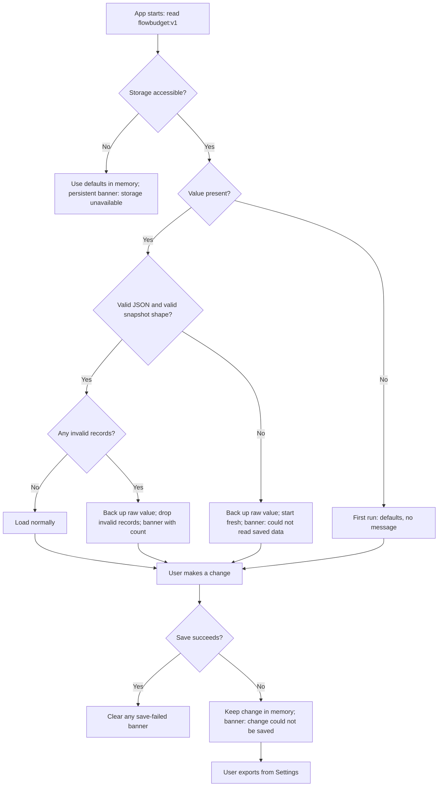

# FlowBudget — User Journeys, Edge Cases and UX States (UI/UX Addendum, Revision 1.2)

| | |
| --- | --- |
| **Status** | Finalized for implementation. Team approval pending; see [README](README.md#status-and-evidence). |
| **Extends** | UI/UX Specification v1.0 §4 "Page wireframe specifications", §5 "Key flows", §7 "UX states to design" and Rev 1.1 "Interaction acceptance" |
| **WBS** | 1.1.2.3 (journeys and edge cases), 1.2.3.3 (empty/error/confirmation states), 1.4.3, 1.5.x acceptance runs |
| **Rules and messages** | [business-rules.md](business-rules.md); validation copy in its §10 |

This document describes **behavior**: what happens, in what order, with what feedback. Visual design (tokens, spacing, wireframes) remains with UI/UX WBS 1.1.3 (Menghor). No visual decision is made here except where behavior needs one.

## 1. Shared interaction rules

These apply to every journey (DEC-34).

| Topic | Rule |
| --- | --- |
| Create and edit forms | Open in a modal dialog titled by action ("Add transaction", "Edit budget"). Below 768px the dialog is a full-screen sheet. Focus moves to the first field. `Enter` in a single-line field submits. |
| Closing a form | **Cancel**, **×** and `Escape` close the dialog and discard unsaved input, without an extra prompt. Clicking the backdrop does **not** close a form dialog, which prevents accidental loss. Focus returns to the control that opened it. |
| Validation timing | On submit, all fields are validated together. Each error shows under its field (linked with `aria-describedby`, field marked `aria-invalid="true"`), and focus moves to the first invalid field. After the first submit, a field re-validates as the user edits it. Typed values are never cleared on error. |
| Destructive actions | Always confirmed in a dialog (§9.3). The destructive button has a specific verb ("Delete", "Reset all data"), never just "OK". **Cancel has initial focus.** `Escape` or the backdrop cancels. |
| Success feedback | A toast (`role="status"`, polite) at the bottom of the screen, auto-dismissed after 4 s, with a manual close button. Toasts never contain the only copy of important information. |
| Error feedback | Inline for fields; banners (§9.4) for storage problems; an error toast only for export failure. |
| Row actions | Each transaction, budget card, goal card and contribution has visible **Edit** / **Delete** (or **Remove**) buttons with accessible names that include the item, e.g. `aria-label="Delete transaction: Lunch, $12.50, Nov 18, 2026"`. |
| Navigation during a dialog | Route changes close any open dialog without saving. |

## 2. J1 — Add, edit and delete transactions

| | |
| --- | --- |
| **Entry points** | `/transactions` → **Add transaction** (page header); Dashboard empty state → link to `/transactions`; row **Edit** / **Delete** |
| **Preconditions** | App loaded (any storage state). Edit or delete needs at least one transaction. The active currency decides the amount format (BR-MONEY-02). |
| **Requirements** | FR-01.1–FR-01.6 · BR-MONEY-*, BR-DATE-02, BR-CAT-*, BR-TXN-*, BR-SORT-01, BR-FLT-* |

**Happy path: add**

1. The user selects **Add transaction**. The dialog opens with Type = Expense, Amount empty (currency symbol shown beside it), Category empty, Description empty, Date = today.
2. The user picks the type. Changing it clears the category (BR-CAT-02).
3. The user enters the amount, e.g. `12.50` (USD) or `25000` (KHR).
4. The user chooses a category from the list for that type.
5. Optionally, the user enters a description (≤ 120 characters).
6. The user keeps or changes the date (`min` 2000-01-01, `max` today).
7. The user selects **Save transaction**.
8. The dialog closes and the toast "Transaction added." appears. In newest-first order the record is at the top. If active filters hide it, the toast reads "Transaction added. It's hidden by your current filters." instead.

**Happy path: edit.** **Edit** on a row → "Edit transaction" pre-filled (amount via BR-MONEY-08) → change any fields → **Save changes** → toast "Transaction updated." The row updates in place; if the date changed, it moves to its new chronological position.

**Happy path: delete.** **Delete** on a row → confirmation (§9.3) → **Delete** → toast "Transaction deleted." Focus moves to the "Transactions" list heading.

**Filters (part of J1, FR-01.5).** Type, Category and From/To dates in a filter bar (it collapses behind a **Filters** button below 768px but stays reachable). Results update as values change; there is no Apply button. When a filter is active, "Showing n of N transactions" and **Clear filters** appear.

| Validation failure | Message code (business-rules §10) |
| --- | --- |
| Amount empty / zero or negative / bad format / >2 decimals (USD) / decimals or commas (KHR) / above maximum | `AMOUNT_REQUIRED` / `AMOUNT_NOT_POSITIVE` / `AMOUNT_INVALID_USD` or `AMOUNT_INVALID_KHR` / `AMOUNT_TOO_MANY_DECIMALS` / `AMOUNT_INVALID_KHR` / `AMOUNT_TOO_LARGE` |
| Category not chosen; category of the other type | `CATEGORY_REQUIRED`; `CATEGORY_TYPE_MISMATCH` |
| Description over 120 characters | `DESCRIPTION_TOO_LONG` |
| Date empty / impossible / before 2000 / after today | `DATE_REQUIRED` / `DATE_INVALID` / `DATE_TOO_EARLY` / `DATE_IN_FUTURE` |
| Filter From after To | `FILTER_RANGE_INVALID` (date range ignored, BR-FLT-03) |
| Record deleted meanwhile (e.g. reset in another tab, then edit here) | `NOT_FOUND` shown at the top of the dialog; Save disabled |

| | |
| --- | --- |
| **Cancellation** | Cancel, × or Escape discards and closes, and the record is unchanged. Cancel in the delete dialog keeps the record. |
| **Success feedback** | Toasts: "Transaction added." · "Transaction updated." · "Transaction deleted." |
| **Cross-page effects** | Dashboard KPIs, both charts and recent list (for the affected months); budget spent for `(category, month)`, both old and new on edit; persisted snapshot. Goals: none. |
| **Acceptance** | AC-01.1–AC-01.6. **J1-E2E:** with the fixture, add a food expense of `5.00` dated today → `/` shows Nov expenses $282.51 and `/budgets` shows Food & dining spent $42.51 (85%). Delete it → both return to $277.51 and $37.51 (business-rules §11.7). |

## 3. J2 — Create, edit and delete monthly budgets

| | |
| --- | --- |
| **Entry points** | `/budgets` → **Create budget**; empty-state **Create budget**; card **Edit** / **Delete**; month navigator (Previous / Next / This month) |
| **Preconditions** | App loaded. Budgets use expense categories only. The month comes from the page's month selector (BR-BUD-03). |
| **Requirements** | FR-03.1–FR-03.7 · BR-BUD-*, BR-CALC-04 |

**Happy path**

1. The page opens on the current month ("November 2026"). The user goes to another month with **Previous** / **Next** if needed (2000-01…2099-12).
2. The user selects **Create budget**. The dialog title reads "New budget · November 2026". The month is shown read-only.
3. The user chooses an expense category (9 options) and enters a limit.
4. The user selects **Save budget**. The toast "Budget created." appears and the card appears in category-list order.
5. The card shows: category, "Spent $37.51 of $50.00", "75%", a 75% bar, and "On track · $12.49 left". An over-budget card shows "Over budget · Over by $5.00", a full bar and warning styling.
6. **Edit** → "Edit budget · November 2026" → change category and/or limit → **Save changes** → "Budget updated." (To move a budget to another month, delete it and create it in that month.)
7. **Delete** → confirmation → "Budget deleted."

| Validation failure | Message code |
| --- | --- |
| No category | `BUDGET_CATEGORY_REQUIRED` |
| Category already budgeted for this month (create, or edit into it) | `BUDGET_DUPLICATE`, e.g. "A Food & dining budget already exists for November 2026. Edit that budget instead." |
| Limit empty / zero / bad format / too large | `AMOUNT_*` with "limit" wording |

| | |
| --- | --- |
| **Cancellation** | Cancel, × or Escape closes without changes; Cancel in the delete dialog keeps the budget. |
| **Success feedback** | "Budget created." · "Budget updated." · "Budget deleted." |
| **Cross-page effects** | Budgets only. Dashboard and transactions are not affected by budget changes (BR-BUD-07). The snapshot is persisted. |
| **Acceptance** | AC-03.1–AC-03.7. **J2-E2E:** with the fixture on November 2026, cards show `b-01` 75% within, `b-02` 150% over, `b-03` 100% within, `b-06` 0%. Creating Food & dining again shows `BUDGET_DUPLICATE`. December 2026 shows only `b-05`. |

## 4. J3 — Create savings goals and manage contributions

| | |
| --- | --- |
| **Entry points** | `/goals` → **Create goal**; empty-state **Create goal**; Dashboard "Create a goal" / "View goals" links; goal card **Add contribution**, **Edit**, **Delete**; contribution **Remove** |
| **Preconditions** | App loaded. Adding a contribution needs at least one goal. |
| **Requirements** | FR-04.1–FR-04.8 · BR-GOAL-*, BR-CALC-05/06/07 |

**Happy path**

1. **Create goal** → enter name ("Emergency fund"), target (`1000.00`) and optional target date → **Save goal** → toast "Goal created." The card shows "$0.00 of $1,000.00 · 0% · $1,000.00 to go".
2. The page shows the note "Contributions are tracked separately and don't change your income, expenses, or balance." (FR-04.7).
3. **Add contribution** on a card → dialog "Add contribution · Emergency fund" → amount and date (default today) → **Save contribution** → toast "Contribution added." Saved, %, bar and remaining update.
4. If that contribution takes the goal from incomplete to complete, the toast reads "Contribution added. You reached “Emergency fund”!" and the card shows "Goal reached". Overfunded goals also show "{overBy} over target" and the true % (e.g. 110%) with a full bar.
5. Each card's **Contributions (n)** disclosure lists the history, newest first; each entry has a **Remove** button → confirmation → "Contribution removed."
6. **Edit** changes name, target or target date (contributions kept) → "Goal updated." **Delete** → confirmation naming the contribution count → "Goal deleted."

| Validation failure | Message code |
| --- | --- |
| Name empty / over 60 / duplicate (ignoring case) | `GOAL_NAME_REQUIRED` / `GOAL_NAME_TOO_LONG` / `GOAL_NAME_DUPLICATE` |
| Target amount invalid | `AMOUNT_*` with "target amount" wording |
| Target date impossible / out of 2000–2099 | `TARGET_DATE_INVALID` / `TARGET_DATE_OUT_OF_RANGE` |
| Contribution amount invalid | `AMOUNT_*` |
| Contribution date empty / impossible / before 2000 / future | `DATE_REQUIRED` / `DATE_INVALID` / `DATE_TOO_EARLY` / `DATE_IN_FUTURE` |

| | |
| --- | --- |
| **Cancellation** | Cancel, × or Escape closes any goal or contribution dialog without changes; Cancel in a confirmation keeps the goal or contribution. |
| **Success feedback** | "Goal created." · "Goal updated." · "Goal deleted." · "Contribution added." · "Contribution added. You reached “{name}”!" · "Contribution removed." |
| **Cross-page effects** | Dashboard savings summary and goal previews (INV-5). **No** effect on KPIs, charts, transactions or budgets (INV-6). The snapshot is persisted. |
| **Acceptance** | AC-04.1–AC-04.8. **J3-E2E:** with the fixture, add `20.00` to Emergency fund → `/goals` shows 27% and `/` shows "Saved $1,200.00 of $2,150.00 across 4 goals", and Nov net remains $232.49. |

## 5. J4 — Review dashboard financial summaries

| | |
| --- | --- |
| **Entry points** | App root `/`; **Dashboard** in the navigation; "Go to dashboard" on the 404 page |
| **Preconditions** | None. Works with empty data. |
| **Requirements** | FR-02.1–FR-02.7 · BR-CALC-02/03/06/08/10/11 |

**Happy path**

1. Open `/`. The header shows "Dashboard" and the selected month, "November 2026".
2. Read the three KPI cards: Income $510.00, Expenses $277.51, Net balance $232.49 (fixture).
3. Read the 6-month bar chart (Jun–Nov 2026). Hover, tap or focus a month for the tooltip "Oct 2026 · Income $800.00 · Expenses $56.99".
4. Read the category donut and its legend (Housing & rent 72%, …).
5. Scan the recent 5 transactions; **View all** opens `/transactions`.
6. Read "Saved $1,180.00 of $2,150.00 across 4 goals" and the 3 goal previews; **View goals** opens `/goals`.
7. **Previous** → October 2026: the cards and donut update, and the bar chart now ends at Oct 2026 (May–Oct). **This month** returns to November.

| | |
| --- | --- |
| **Validation failures** | None; the page is read-only. **Next** is disabled at the current month (BR-DATE-04). |
| **Cancellation** | Not applicable; navigating away keeps nothing (the month selector resets to the current month on return, DEC-32). |
| **Success feedback** | Not applicable. Charts and cards update immediately on month change. |
| **Cross-page effects** | Read-only. Values must equal those on `/transactions` (filtered), `/budgets` and `/goals` (INV-1…INV-5). |
| **Acceptance** | AC-02.1–AC-02.7. **J4-E2E:** fixture values from business-rules §11.1–§11.3 and §11.6 appear exactly; keyboard-only navigation reaches each chart's tooltip or text alternative. |

## 6. J5 — Update settings, export and reset data

| | |
| --- | --- |
| **Entry points** | `/settings` via navigation; the storage-unavailable banner's "Go to Settings" link; **Export data** buttons inside the currency and reset dialogs |
| **Preconditions** | App loaded. The currency path depends on whether financial records exist (BR-CUR-02). |
| **Requirements** | FR-05.1–FR-05.5 · BR-CUR-*, BR-EXP-* |

**5a Theme.** A two-option control (Dark / Light, current one selected). Selecting applies it to the whole app immediately, saves it, and shows the toast "Theme set to light." There is no confirmation.

**5b Currency.** A two-option control (USD / KHR).

1. With **no** financial records, selecting KHR switches immediately with the toast "Currency set to KHR."
2. With records, selecting KHR opens the warning dialog (§9.3) with the counts. The control does not change yet.
3. **Export data** downloads the JSON and keeps the dialog open.
4. **Delete records and switch** clears transactions, budgets and goals, sets KHR, keeps the theme, and shows "Records cleared. Currency set to KHR." Dashboard, Budgets and Goals now show their empty states. New amount fields accept whole riel.
5. **Cancel** or `Escape`: the control shows USD again and nothing changes.

**5c Export.** **Export data** → self-check (BR-EXP-02) → download `flowbudget-export-2026-11-18.json` → toast "Data exported." If the check or the download fails, the toast "Export failed. Please try again." appears.

**5d Reset.** **Reset all data** → confirmation (§9.3, with Export) → **Reset all data** → factory defaults (BR-CUR-04) → toast "All data reset." The theme becomes dark, the currency USD.

**5e Storage notice.** Always visible on Settings (§9.4, FR-05.5).

| | |
| --- | --- |
| **Validation failures** | None from user input (controls only offer valid values). Export self-check failure → error toast. |
| **Cancellation** | Currency and reset dialogs: Cancel, Escape or the backdrop leaves all data and settings unchanged. |
| **Success feedback** | "Theme set to {light/dark}." · "Currency set to {USD/KHR}." · "Records cleared. Currency set to {USD/KHR}." · "Data exported." · "All data reset." |
| **Cross-page effects** | Theme: every page. Currency switch with records or reset: every page returns to empty states; amount formats change everywhere. Export: none. The snapshot is persisted after each change. |
| **Acceptance** | AC-05.1–AC-05.5. **J5-E2E:** with the fixture, export → the file deep-equals the stored `flowbudget:v1`. Switch to KHR → the dialog says "14 transactions, 6 budgets, and 4 savings goals"; Cancel → all still present; confirm → all empty, KHR active, theme unchanged. |

## 7. J6 — Recover gracefully from storage errors

| | |
| --- | --- |
| **Entry points** | Any page load (load problems); any data change (save problems) |
| **Preconditions** | One of: stored data unreadable, partly invalid, storage blocked, or storage full |
| **Requirements** | FR-06.3, FR-06.4 · BR-STO-02…BR-STO-07, DEC-24, DEC-25 |

**Happy path (recovery):**

1. The app starts and, for example, finds `{not json` in `flowbudget:v1`.
2. It backs up the raw value to `flowbudget:v1:backup`, loads empty defaults, and shows the load error banner on every page until dismissed.
3. The user can keep working; the next save writes a valid snapshot.
4. For partly invalid data, valid records appear normally and the banner states how many items were skipped.
5. For a save failure (storage full), the user's change stays visible. A banner explains it and points to Export. The next successful save clears the banner.

| | |
| --- | --- |
| **Validation failures** | Not applicable (no user input). All handled conditions are listed in BR-STO-03/04. |
| **Cancellation** | The load banners are dismissible for the session (**Dismiss**). The unavailable banner cannot be dismissed while storage stays unavailable. |
| **Success feedback** | Banners disappear on dismissal or after the next successful save. |
| **Cross-page effects** | Banners appear in the shared layout above page content on every route. |
| **Acceptance** | AC-06.3, AC-06.4. **J6-E2E (DevTools):** (1) set `flowbudget:v1` to `{not json`, reload → no crash, empty app, load banner, backup key present. (2) Paste the fixture with one transaction's `amountMinor` set to `-5`, reload → 13 transactions, banner "1 saved item couldn't be read and was skipped." (3) Block site storage, reload → app works, unavailable banner. |

## 8. Cross-page effects matrix

| Action | Dashboard cards and charts | Recent list | Savings summary | Transactions list | Budgets | Goals | Persisted |
| --- | --- | --- | --- | --- | --- | --- | --- |
| Add, edit or delete transaction | ✔ affected month(s) | ✔ | — | ✔ | ✔ matching (category, month) | — | ✔ |
| Create, edit or delete budget | — | — | — | — | ✔ | — | ✔ |
| Create or edit goal | — | — | ✔ | — | — | ✔ | ✔ |
| Delete goal | — | — | ✔ | — | — | ✔ | ✔ |
| Add or remove contribution | — | — | ✔ | — | — | ✔ | ✔ |
| Theme change | visual only | visual only | visual only | visual only | visual only | visual only | ✔ |
| Currency switch with records / reset | ✔ (empty) | ✔ (empty) | ✔ (empty) | ✔ (empty) | ✔ (empty) | ✔ (empty) | ✔ |
| Export | — | — | — | — | — | — | — |

## 9. UX states and copy

All user-facing copy for states is defined here so that pages stay consistent. Validation messages are in business-rules §10. Counts use correct singular and plural forms ("1 transaction", "2 transactions").

### 9.1 Empty and no-data states

| Location | Condition | Title | Body | Action |
| --- | --- | --- | --- | --- |
| Dashboard | No transactions at all | No transactions yet | Add your first income or expense to see your monthly summary. | Link **Add transaction** → `/transactions` |
| Dashboard donut | No expenses in the selected month | — | No expenses in {Month YYYY}. | — |
| Dashboard bar chart | All 6 months zero | — | No income or expenses from {Mon YYYY} to {Mon YYYY}. | — |
| Dashboard savings | No goals | — | No savings goals yet. | Link **Create a goal** → `/goals` |
| Transactions | No transactions | No transactions yet | Record income or an expense to start tracking. | **Add transaction** |
| Transactions | Filters match nothing | No transactions match these filters. | — | **Clear filters** |
| Budgets | No budgets in the selected month | No budgets for {Month YYYY} | Set a monthly spending limit for a category. | **Create budget** |
| Goals | No goals | No savings goals yet | Create a goal and log contributions as you save. | **Create goal** |
| Goal card | No contributions | — | No contributions yet. | **Add contribution** |
| 404 | Unknown route | Page not found | The page you're looking for doesn't exist. | Link **Go to dashboard** |

There is no loading state: hydration is synchronous (DEC-23), which replaces the "loading and hydration skeletons" item in UI/UX §7.

### 9.2 Success toasts

| Event | Toast |
| --- | --- |
| Transaction added / updated / deleted | "Transaction added." / "Transaction updated." / "Transaction deleted." |
| Transaction added but filtered out | "Transaction added. It's hidden by your current filters." |
| Budget created / updated / deleted | "Budget created." / "Budget updated." / "Budget deleted." |
| Goal created / updated / deleted | "Goal created." / "Goal updated." / "Goal deleted." |
| Contribution added / reaches goal / removed | "Contribution added." / "Contribution added. You reached “{name}”!" / "Contribution removed." |
| Theme / currency (no records) / currency with reset | "Theme set to {light/dark}." / "Currency set to {USD/KHR}." / "Records cleared. Currency set to {USD/KHR}." |
| Export / export failure | "Data exported." / "Export failed. Please try again." (error style) |
| Reset | "All data reset." |

### 9.3 Confirmation dialogs

| Dialog | Title | Body | Buttons (destructive last) |
| --- | --- | --- | --- |
| Delete transaction | Delete this transaction? | {Category} · {amount} · {date}. This can't be undone. | Cancel · **Delete** |
| Delete budget | Delete the {Category} budget for {Month YYYY}? | Your transactions won't be affected. | Cancel · **Delete** |
| Delete goal | Delete “{name}”? | This also removes its {n} contribution(s) ({saved} saved). This can't be undone. | Cancel · **Delete** |
| Remove contribution | Remove this contribution? | {amount} on {date} will be removed from “{name}”. | Cancel · **Remove** |
| Switch currency (records exist) | Switch currency to {KHR/USD}? | FlowBudget doesn't convert amounts. Switching will permanently delete your {t} transaction(s), {b} budget(s), and {g} savings goal(s). Your theme stays the same. Export your data first if you want a copy. | Export data · Cancel · **Delete records and switch** |
| Reset all data | Reset all FlowBudget data? | This permanently deletes all transactions, budgets, savings goals, and settings in this browser. Settings return to USD and the dark theme. Export your data first if you want a copy. | Export data · Cancel · **Reset all data** |

Cancel has initial focus in every dialog. Escape and the backdrop act as Cancel. The dialog is `role="alertdialog"` with its title and body linked by `aria-labelledby` / `aria-describedby`.

### 9.4 Banners and notices

| ID | When | Role | Text | Actions |
| --- | --- | --- | --- | --- |
| N-STORAGE | Always, on /settings | none (static) | **Your data stays in this browser.** FlowBudget doesn't upload anything. Clearing browser data, using private browsing, or switching browsers or devices means your data won't be there. Export regularly to keep a copy. | **Export data** |
| N-LOAD-RESET | `loadResult = reset` | `alert` | We couldn't read your saved data, so FlowBudget started fresh. A copy of the unreadable data was kept in this browser. | **Dismiss** |
| N-LOAD-REPAIRED | `loadResult = repaired` | `status` | {n} saved item(s) couldn't be read and {was/were} skipped. Everything else loaded normally. | **Dismiss** |
| N-UNAVAILABLE | `persistent = false` | `alert` | Browser storage is unavailable, so changes will be lost when you close this tab. Export your data from Settings to keep a copy. | **Go to Settings** (not dismissible) |
| N-SAVE-FAILED | `lastSaveError ≠ null` | `alert` | Your latest change couldn't be saved because browser storage is full or blocked. Export your data from Settings to keep a copy. | **Go to Settings** (clears after the next successful save) |
| N-GOALS-SEPARATE | Always, on /goals | none (static) | Contributions are tracked separately and don't change your income, expenses, or balance. | — |

Banners sit in the shared layout above the page `<h1>`, in this order: N-UNAVAILABLE, N-SAVE-FAILED, N-LOAD-RESET or N-LOAD-REPAIRED.

## 10. Edge cases

| # | Edge case | Expected behavior | Rule |
| --- | --- | --- | --- |
| E-01 | Transaction on the last or first day of a month (`2026-10-31`, `2026-11-01`) | Counts only in its own month on the dashboard and in budgets | BR-CALC-01 |
| E-02 | User enters an expense at 00:30 local time | Date defaults to the local date, not yesterday (no UTC conversion) | BR-DATE-01 |
| E-03 | Tab left open past midnight, then a transaction dated "today" is saved | Accepted; "today" is evaluated at submit | BR-DATE-06 |
| E-04 | Two transactions on the same date | The one added later appears first in newest-first order; recent list order is stable | BR-SORT-01 |
| E-05 | Editing a transaction's date into another month | Both months' totals and budgets recalculate | BR-TXN-03 |
| E-06 | Changing type from Expense to Income in the form | Category clears; income categories offered | BR-CAT-02 |
| E-07 | Expense recorded in a category with no budget | Counts in dashboard totals and category chart; no budget card | BR-BUD-06 |
| E-08 | Spending exactly equal to the limit | "On track · $0.00 left", 100%, not over | BR-CALC-04 |
| E-09 | Spending far above the limit (e.g. 1,000%) | Text shows "1000%" and "Over by …"; bar capped at 100% | BR-CALC-04 |
| E-10 | Budget for a future month | Allowed; spent 0 | BR-BUD-06 |
| E-11 | Contribution that overshoots the target | Accepted; true % shown, bar 100%, "over target" text | BR-GOAL-04/05 |
| E-12 | Lowering a goal target below the saved amount | Goal becomes complete; nothing deleted | BR-GOAL-06 |
| E-13 | Removing the contribution that completed a goal | Goal becomes incomplete again | BR-GOAL-07 |
| E-14 | Goal target date already passed while incomplete | "Past target date" label; contributions still allowed | BR-GOAL-02 |
| E-15 | Description with HTML or script text | Rendered as literal text | NFR-05 |
| E-16 | Maximum amounts on a 360px screen | Shown in full (may wrap, never clipped or overflowing) | NFR-02 |
| E-17 | Net balance negative | "-$12.50" with a text label and negative styling | BR-CALC-02 |
| E-18 | Switching currency with no records | Immediate, no dialog | BR-CUR-02 |
| E-19 | Selecting the currency that is already active | No change, no dialog, no toast | BR-CUR-02 |
| E-20 | Two tabs open and both edit data | Last save wins; no merge (documented limitation) | BR-STO-08 |
| E-21 | Phone testing over `http://` on the LAN | IDs still generated (fallback) | data-contracts §2.1 |
| E-22 | User clears site data while the app is open | In-memory data stays visible and is re-saved on the next change | BR-STO-01 |
| E-23 | Very long goal name or description in cards and rows | Visually truncated with ellipsis; full text in edit form and accessible name | BR-TXN-02 |
| E-24 | Direct visit or refresh on `/goals` in production | Goals page loads (SPA rewrite) | DEC-30 |
| E-25 | Unknown URL such as `/budget` | 404 page with link to Dashboard | FR-07.3 |
